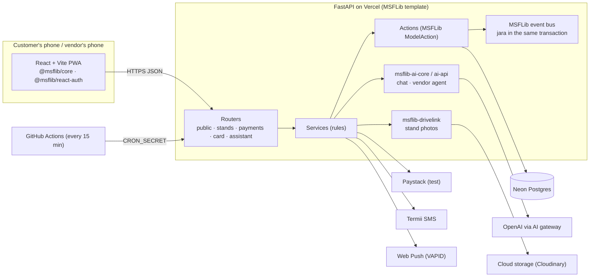

<div align="center">

# 🌶️ Customa

### A friendly AI character for every food stand/restaurant

**Customers scan. The stand's character greets them by name, counts their plate, and every 6th plate earns a *jara*: a free extra portion.**

[**Live app**](https://customa-web.vercel.app) · [**API docs**](https://customa-api.vercel.app/docs) · [**Feature docs**](docs/)

Built for the **KodeHauz Decennium Sprint** on **MSFLib** · FastAPI · React · Neon Postgres · Vercel

</div>

---

## Contents

- [The problem](#the-problem)
- [What Customa does](#what-customa-does)
- [A customer's visit](#a-customers-visit)
- [The vendor's day](#the-vendors-day)
- [All features](#all-features)
- [How MSFLib carries the app](#how-msflib-carries-the-app)
- [Architecture](#architecture)
- [Security and privacy](#security-and-privacy)
- [Tests](#tests)
- [Run it locally](#run-it-locally)
- [Configuration](#configuration)
- [Deploy](#deploy)
- [Project layout](#project-layout)
- [Feature docs](#feature-docs)
- [What's next](#whats-next)

---

## The problem

Food vendors in Uyo, Nigeria, told us their biggest daily worry is **getting enough customers**,
so the food they cook sells out instead of going to waste overnight.

- They know their regulars by face, not by name.
- They have no till, no loyalty app and no marketing budget.
- Paper stamp cards get lost, faked or forgotten.

Customa gives every stand a **mascot that remembers customers** and rewards coming back. It runs
in the phone's browser: no app to download, no hardware, a printed QR code on the stand is enough.

## What Customa does

| For customers | For vendors |
|---|---|
| Scan the QR code, and the stand's own character says hello (by name, from the second visit) | A live dashboard: plates today, customers, who came back, ratings |
| A stamp card that fills up: every 6th plate is a free *jara* | **"Who's here now"**: regulars who just arrived, so staff greet them by name |
| Spin the **Prize Wheel** for the jara | A QR sign to print, with a scan code that stops fake stamps |
| Chat with the character about the menu | **"Ask about your stand"**: an AI helper that answers from the stand's own numbers |
| Pay for a plate on the phone or in cash | **Today's payments**: card and cash totals |
| Save the card to a phone number and get it back on any phone or browser | Leftover food? **"Tell my customers"** sends an alert |
| Plan the next visit, with a calendar reminder | **"Coming today"**: who plans to come, so the vendor cooks the right amount |

## A customer's visit

```
 Scan QR at the stand ──► Character greets you ──► Plate counted: PLATE 3/8 (2 gift stamps)
          │                                                  │
          ▼                                                  ▼
 "Save your card so you never lose it"          "When you go come back?" ── plan + calendar reminder
          │                                                  │
          ▼                                                  ▼
 Pay for the plate (card / cash)               6th real plate ──► JARA! ──► spin the Prize Wheel
```

1. **Scan.** The QR code carries a secret scan code, so only a real scan at the stand counts a
   plate. A bookmark, a shared link or the browser history never does.
2. **Get greeted.** The stand's own character (a pepper, pot, panda, chick, bunny, cat...)
   welcomes the customer in the vendor's voice, Pidgin included.
3. **Collect stamps.** One plate counts per visit, with a 6-hour window. Every new card starts
   with 2 welcome-gift stamps, so it feels already started.
4. **Earn a jara.** On the 6th real plate the customer gets a one-time code, or a spin on the
   Prize Wheel. The vendor checks the code, and it works once.
5. **Come back.** They plan the next visit, get a reminder, turn on leftover-food alerts, and are
   greeted as a regular.

## The vendor's day

1. **Sign up** with email or Google, describe the stand in their own words, and get a character
   suggested by AI.
2. **Add the menu**, with a price for every food (one food box and one price box per row).
3. **Print the QR sign** and stick it on the stand.
4. **Watch the dashboard live**: who's here now, plates, payments, plans and the share of
   customers who came back within 14 days.
5. **Ask the AI helper**: "How did this week go?", "When am I busiest?", "Who are my regulars?"
6. **Sell leftovers** before closing with one tap ("Tell my customers").

## All features

<details open>
<summary><b>Loyalty core</b></summary>

- **Stamp card with a jara on the 6th plate.** The rule lives in one place: one plate per window
  (6 hours by default, per stand), checked with a row lock so double taps can't count twice.
- **Head-start card**: 2 gift stamps on every new card (display only; the jara still needs 6 real
  plates).
- **Prize Wheel**: up to 6 of the vendor's foods. The server picks the prize, the customer gets a
  one-time code and the vendor redeems it.
- **Surprise jara** and **today's special**, set by the vendor.
- **Plate Ajo**: prepay 5 or 10 plates at today's price, by transfer to the vendor's own account.
- **Lunch Crew**: friends share one card, and each crew jara goes to the next member in turn.

</details>

<details open>
<summary><b>Coming back</b></summary>

- **"Ime don land!"**: staff see regulars who just arrived, with a greeting in the stand's voice,
  plus an optional phone ping.
- **"When you go come back?"**: plan a day and time, add it to the calendar (`.ics`) and get a
  reminder by push (or SMS where enabled).
- **Leftover-food alerts** by web push or SMS (Termii) when the vendor taps "Tell my customers".
- **Return rate**: % of customers who came back within 14 days, from real visits only.

</details>

<details open>
<summary><b>Payments</b></summary>

- **Pay for a plate** by card or transfer with **Paystack (test mode only)**, or cash with a
  3-letter code the vendor matches.
- A paid plate counts as a stamp. Paystack's own verify call and a signed webhook confirm every
  payment, and it is marked paid exactly once.
- **Today's payments** on the dashboard.

</details>

<details open>
<summary><b>The card follows the customer</b></summary>

- **Save your card** to a phone number and a 4-digit PIN.
- **"Already have a card?"**: get it back in another browser, WhatsApp's in-app browser, a private
  tab or the iPhone Home Screen app. Every plate, jara and plan stays.
- A 6-digit SMS code is offered when texts are on.
- Lockouts, rate limits, no number enumeration and a full attempt log.

</details>

<details open>
<summary><b>AI</b></summary>

- **Chat with the character**: short, warm and private. It remembers a little (that the customer
  can see and clear) and answers only from the real menu.
- **Character from the vendor's words**: describe the stand, and AI suggests the character.
- **Ask about your stand**: an AI agent for vendors with read-only tools over the stand's own
  numbers.

</details>

<details open>
<summary><b>Look and feel</b></summary>

- Animated character kit, one character per stand, and loaders that show the stand's own
  character.
- Stand photo, installable **Home Screen app** (opens straight on the stand), and quick games with
  the character.
- A designed **dark theme**: warm surfaces, off-white text and a pepper accent. The
  **Light / System / Dark** switch is at the bottom of every page and in the vendor header.
- Built for **cheap Android phones**: 360 px layouts, big tap targets, small payloads.

</details>

## How MSFLib carries the app

MSFLib carries every main flow, used as its docs describe: auth, workspaces, tiered settings,
models and actions, the event bus, AI core, AI API, conversation and drivelink.

| Customa feature | MSFLib (backend) | MSFLib (frontend) | Our code |
|---|---|---|---|
| Vendor sign-up, sign-in, protected routes | `msflib-auth` (JWT login, `get_current_active_account`), `msflib-account` (accounts, open registration) | `@msflib/react-auth` (`AuthProvider`, `useAuth`) | POST `/logout` shim for react-auth |
| A stand per vendor | `msflib-workspaces` (`WorkspaceAction.create_with_owner`, membership), `msflib-tenancy` (default tenant), membership checks from `msflib-auth` (`get_user_dependencies`, `PathParameterResolver`) | | `services/stands.py` |
| Count a plate, block repeats | core `ModelBase` tables + `ModelAction` (`VisitAction.count_plate` holds the one-plate-per-window rule) | `@msflib/core` `configuredApiClient` | `actions/customa.py` |
| Per-stand settings (6-hour window, feature switches) | core tiered settings (`ModuleSettingsBase`, namespace `CUSTOMA`) + `msflib-workspace-config` (`ScopedConfigService`: per-stand override) | | `CustomaSettings` |
| Jara on the 6th plate | core event bus: a `visit-create-pre-commit` listener issues the reward **in the same transaction** | | `eventbus/__init__.py` |
| Redeem a jara once | core `ModelAction.update` | | `/stands/{slug}/jara/{code}/redeem` |
| Chat with the character | `msflib-ai-core` (`get_ai_dependencies().get_llm()`, `TokenUsageCallback`) | | persona + guardrails, menu fallback (`services/bisi.py`) |
| Food questions the vendor can read (chats stay private) | `msflib-conversation` (`ChannelService`, `AccessService`, `MembershipService.add_agent`, `MessagingService`) | | `services/chat_log.py` |
| Character from the vendor's own words | `msflib-ai-core` model, output validated by a Pydantic schema, one retry, safe default | | `suggest_character` |
| Pay for a plate (Paystack test mode or cash); a paid plate is a stamp | core `ModelBase` table `Payment` + `ModelAction` (`PaymentAction`); `msflib-workspace-config` per-stand `PAYMENTS_ENABLED` | `@msflib/core` `configuredApiClient` | `services/paystack.py`, `services/payments.py`, `endpoints/payments.py`, `features/payments/` |
| Card follows the customer (phone number + PIN) | core `ModelBase` tables + `ModelAction`s; `msflib.core.security` (bcrypt) for PINs and codes; `msflib.utils.random.random_digits` for SMS codes; `msflib-workspace-config` `CARD_RECOVERY_ENABLED` | `@msflib/core` `configuredApiClient` | `services/card_recovery.py`, `features/cardRecovery/` |
| Ask about your stand (vendor AI helper) | `msflib-ai-api` `create_agent_router` at `/stands/{slug}/assistant` behind the stand-member check; tools in an `msflib-ai-core` `StaticToolRegistry`, each scoped by ai-api's `ScopeEnvelope` | | `services/stand_assistant.py`, `features/assistant/` |
| Stand photos in the vendor's drive | `msflib-drivelink` `DrivelinkService.create_file` / `DrivelinkAction` (folders, upload checks, storage, hard delete) over `msflib.utils.uploads` storage | | `services/stand_photo.py` |
| App shell | the official **MSFLib FastAPI template** (settings, session, keystore, auth/account routers, workspace hooks) | `@msflib/core` `configureApplication` | |

**Where MSFLib has no module, we built from MSFLib's pieces instead of bolting on.**
- **Payments:** MSFLib has no payments module, so payments use `ModelBase`, `ModelAction` and
  workspace-config.
- **Customer identity:** `msflib-auth` and `msflib-account` are designed for vendor logins, so
  customers stay anonymous. Their cards use MSFLib's security helpers instead.

## Architecture



**Layers:** routers stay thin (HTTP in and out), `services/` hold the rules, `actions/` are MSFLib
`ModelAction`s (all database writes), and `models/` are MSFLib `ModelBase` tables. On the
frontend, every feature lives in `frontend/src/features/<feature>/` with its own API module,
components and CSS.

## Security and privacy

- **Anti-cheat:**
  - one plate per window per customer, enforced with a database row lock;
  - a plate counts only with the QR code's scan code, and vendors can replace the QR code if it
    was copied;
  - getting a card back never gives an extra plate.
- **Customers are anonymous:** a random key on their phone. A first name is kept only with
  consent.
- **Vendors never see phone numbers, chats or customer keys:** they see first names (if given),
  plates, ratings and food questions.
- **Phone numbers are never stored in plain text:**
  - card recovery keeps a keyed hash (HMAC-SHA256) and a masked form (`0803 ••• 4521`);
  - PINs and codes are hashed with bcrypt, after a server-side pepper;
  - lockouts and IP limits apply, unknown numbers look exactly like wrong PINs, and every attempt
    is logged.
- **Payments are test mode only:** live Paystack keys are refused. Prices come from the server's
  menu, and a payment is paid only when Paystack's verify call says so. The webhook is
  HMAC-SHA512 signed.
- **"Delete my data"** on the customer page removes the customer's data at that stand: chats,
  plates, jara, plans, arrivals, alerts and the saved phone link. Paid payments stay as the
  vendor's takings, without the customer.
- **Vendor-only routes** check that the signed-in account is a member of that stand, including
  the AI helper.
- **Secrets** live only in Vercel environment variables, never in the repo.

## Tests

```bash
cd backend
pytest app/tests                                   # backend
pytest app/tests/api/api_v1/test_msflib_depth.py   # against the real MSFLib packages
cd ../frontend && pnpm tsc --noEmit && pnpm build  # typecheck + build
```

- **The rules:** plate window, jara, head-start card, crew, Ajo, Prize Wheel, regulars, plans,
  alerts, SMS, payments (with a fake Paystack), card recovery, delete-my-data.
- **Databases:** the suite runs on both SQLite and Postgres.
- **Real MSFLib:** `test_msflib_depth.py` checks:
  - the ai-api agent calls stand-scoped tools;
  - staff-only access (401 / 403);
  - drivelink stores, replaces and deletes photos.

## Run it locally

**Backend** (Python 3.11+, Poetry). MSFLib is a private repo: set up access as the organisers
describe.

```bash
cd backend
cp .env-example .env                     # set SECRET_KEY, USE_SQLITE=true, ...
poetry install
poetry run python -m app.initial_data    # tables + first vendor
poetry run uvicorn app.main:app --reload # http://localhost:8000/docs
```

**Frontend** (Node 20+, pnpm). The `@msflib/*` packages come from GitHub Packages, so set
`NPM_TOKEN`.

```bash
cd frontend
echo "VITE_API_URL=http://localhost:8000/api/v1" > .env
pnpm install
pnpm dev                                 # http://localhost:5173
```

A stand's customer page is `/s/{slug}`, its printable QR sign is `/qr/{slug}`, and the vendor
dashboard is `/vendor`.

## Configuration

All settings are environment variables (see `backend/.env-example`). Everything optional switches
itself off cleanly when unset.

| Variable | What it does |
|---|---|
| `SECRET_KEY` | Signs logins and keys the card-recovery hashes. **Required; must stay the same.** |
| `POSTGRES_*` / `USE_SQLITE` | Database (Neon in production) |
| `LLM_PROVIDER`, `LLM_BASE_URL`, `LLM_MODEL`, `LLM_API_KEY` | AI chat, character suggestion and the vendor helper (optional: without a key the chat answers from the menu) |
| `VAPID_PUBLIC_KEY`, `VAPID_PRIVATE_KEY`, `VAPID_SUBJECT` | Web push alerts and reminders |
| `TERMII_API_KEY`, `TERMII_SENDER_ID`, `TERMII_BASE_URL`, `TERMII_CHANNEL` | SMS alerts, reminders and card-recovery codes |
| `PAYSTACK_SECRET_KEY` | Paystack **test** key (`sk_test_...`) for card payments |
| `CRON_SECRET` | Protects the plan-reminder endpoint (also a GitHub secret, with `CUSTOMA_API_URL`) |
| `STAND_PHOTOS_IN_DRIVELINK`, `STORAGE_METHOD`, `CLOUDINARY_*` | Stand photos in the vendor's drivelink drive (cloud storage) |
| `PUBLIC_WEB_URL` | The customer site (Paystack returns customers here) |

Per-stand switches (vendor dashboard or workspace-config, namespace `CUSTOMA`):
`PLATE_WINDOW_SECONDS`, `PLATES_FOR_JARA`, `HEAD_START_STAMPS`, `PAYMENTS_ENABLED`,
`CARD_RECOVERY_ENABLED`, `PLATE_AJO_ENABLED`, `LUNCH_CREW_ENABLED`, `SURPRISE_JARA_ENABLED`,
`PLAN_SMS_REMINDERS`, and more in `backend/app/core/config.py`.

## Deploy

- **Hosting:** both apps run on **Vercel** (`backend/vercel.json`, `frontend/vercel.json`), with
  **Neon Postgres**.
- **MSFLib on Vercel:** Vercel can't read the private MSFLib repo, so the backend deploy uploads
  MSFLib wheels built locally from the pinned commits (`backend/vendor-wheels/`, not committed).
- **Migrations:** each feature adds new tables only. Its SQL migration in
  `backend/scripts/migrations/` runs on Neon **before** the backend deploy, and each one is safe to
  run twice.
- **Plan reminders:** `.github/workflows/plan-reminders.yml` sends them every 15 minutes.

```bash
cd backend  && vercel --prod   # API first
cd frontend && vercel --prod   # then the web app
```

## Project layout

```
backend/app/
  core/config.py             settings: MSFLib modules + CustomaSettings (per-stand)
  models/                    MSFLib ModelBase tables (one file per feature)
  actions/                   MSFLib ModelActions: every database write
  services/                  the rules: plates, payments, card_recovery, stand_assistant, ...
  eventbus/                  jara listener (same transaction as the plate)
  api/api_v1/endpoints/      thin routers: public (customer), stands (vendor), payments, ...
  tests/                     API tests per feature (+ real-MSFLib tests)
backend/scripts/migrations/  one SQL file per feature, run on Neon before deploy
frontend/src/
  application.ts             configureApplication (MSFLib)
  api.ts                     configuredApiClient calls
  components/                Character kit, ThemeSwitch, Loading, MenuRows, ...
  features/<feature>/        payments, cardRecovery, assistant, prizeWheel, regulars, ...
  pages/                     Customer, Chat, Vendor (sign-in, setup, dashboard), QR
docs/                        one document per feature (how it works, setup, acceptance criteria)
```

## Feature docs

| Doc | Covers |
|---|---|
| [return-visit-features.md](docs/return-visit-features.md) | Plate Ajo, Lunch Crew |
| [return-visit-boosters.md](docs/return-visit-boosters.md) | Head-start card, "Who's here now", plan the next visit, 14-day return rate |
| [prize-wheel.md](docs/prize-wheel.md) | Prize Wheel |
| [character-chat-and-delights.md](docs/character-chat-and-delights.md) | Character chat, surprise jara, today's special |
| [scan-and-alerts.md](docs/scan-and-alerts.md) | Real-scan rule, leftover-food alerts (push and SMS) |
| [payments.md](docs/payments.md) | Paystack test mode and cash payments |
| [customer-card-recovery.md](docs/customer-card-recovery.md) | Save your card, "Already have a card?" |
| [msflib-ai-api-and-drivelink.md](docs/msflib-ai-api-and-drivelink.md) | Vendor AI helper, stand photos in drivelink |
| [stand-look-and-install.md](docs/stand-look-and-install.md) | Characters, stand photo, Home Screen app, games |
| [google-sign-in.md](docs/google-sign-in.md) | Google sign-in for vendors |

## What's next

- **Live payments** with Paystack subaccounts, so money goes straight to each vendor.
- **WhatsApp** greetings and reminders.
- **Multi-stand insights** for vendors with more than one stand.
- **Offline-first** counting for stands with poor network.

---

<div align="center">

Made with 🌶️ in Uyo for the vendors who feed us every day.

**[Try Customa →](https://customa-web.vercel.app)**

</div>
